<div align="center">


<a href="https://github.com/Chandankumar775/nutrisense-ai">
  
</a>

<p>
  
  
  
  
  
</p>

<a href="https://github.com/Chandankumar775/nutrisense-ai/releases/latest/download/NutriSense-AI.apk">
  
</a>

<br/><br/>

<sub><i>AI Nutrition Detection and Diet Suggestion using Deep Learning · IDP P020 · Mentor: Dr. Vivek Sharma</i></sub>

</div>

---

## 

> **Not a calorie counter.** NutriSense AI turns a photo or log of a meal into a *decision*:
> it estimates your requirements from your profile, finds possible nutrient gaps
> (iron, vitamin D, B12, protein, calcium, fiber…) and recommends specific Indian foods that close them —
> with the reason shown (“**+38% iron**”).

```
 profile ─▶ scan / log meal ─▶ requirement estimation ─▶ gap analysis ─▶ recommendations ─▶ coaching
```

---

## 

**Direct link:** [NutriSense-AI.apk](https://github.com/Chandankumar775/nutrisense-ai/releases/latest/download/NutriSense-AI.apk) (~12.7 MB)

**Command line:**

```bash
# Linux / macOS / Git Bash
curl -L -o NutriSense-AI.apk https://github.com/Chandankumar775/nutrisense-ai/releases/latest/download/NutriSense-AI.apk
```

```powershell
# Windows PowerShell
iwr https://github.com/Chandankumar775/nutrisense-ai/releases/latest/download/NutriSense-AI.apk -OutFile NutriSense-AI.apk
```

```bash
# Install straight to a USB-connected phone
adb install NutriSense-AI.apk
```

> On the phone, allow *Install unknown apps* for your browser / file manager when prompted.

---

## 

<div align="center">

<table>
  <tr>
    <td align="center">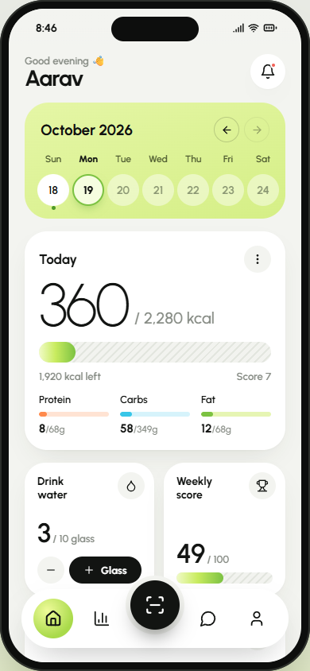<br/><sub><b>Home</b></sub></td>
    <td align="center">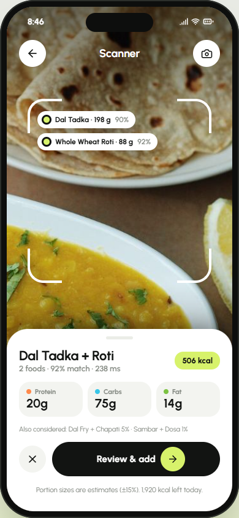<br/><sub><b>Scan result</b></sub></td>
    <td align="center">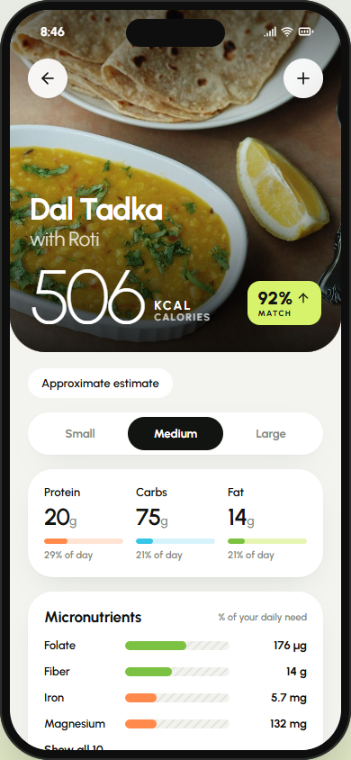<br/><sub><b>Meal details</b></sub></td>
    <td align="center">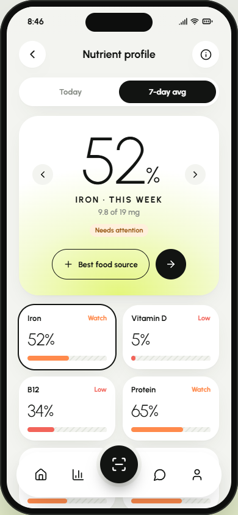<br/><sub><b>Nutrient gaps</b></sub></td>
  </tr>
  <tr>
    <td align="center">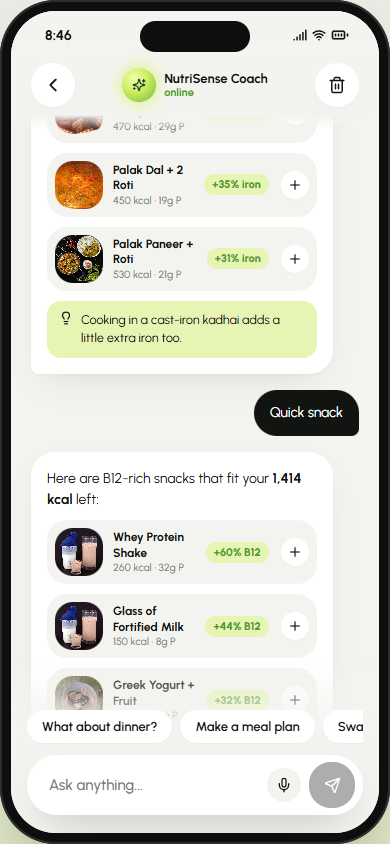<br/><sub><b>AI Coach</b></sub></td>
    <td align="center">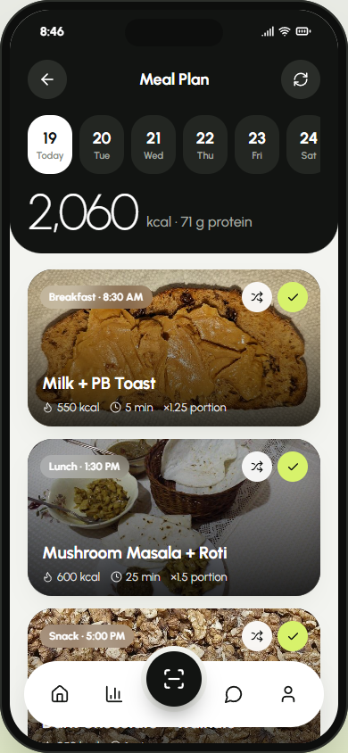<br/><sub><b>7-day meal plan</b></sub></td>
    <td align="center">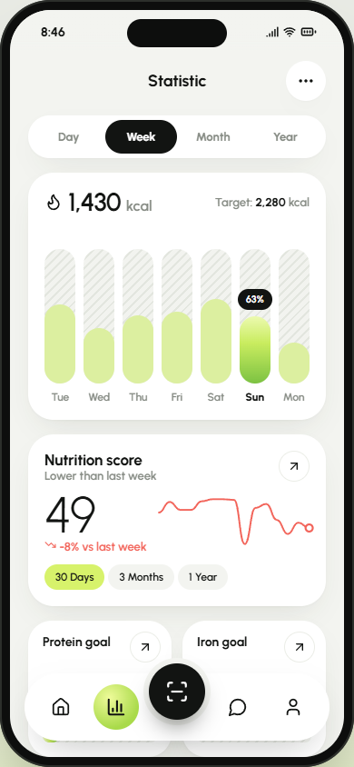<br/><sub><b>Progress</b></sub></td>
    <td align="center">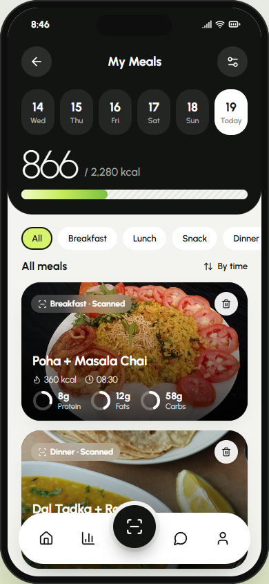<br/><sub><b>Food diary</b></sub></td>
  </tr>
  <tr>
    <td align="center">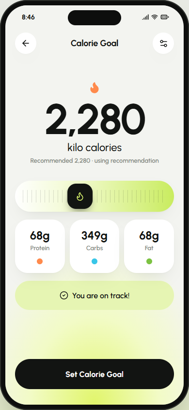<br/><sub><b>Calorie goal</b></sub></td>
    <td align="center">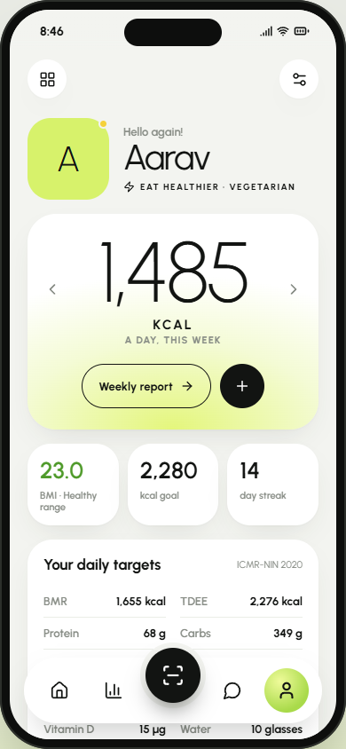<br/><sub><b>Profile</b></sub></td>
    <td align="center" colspan="2">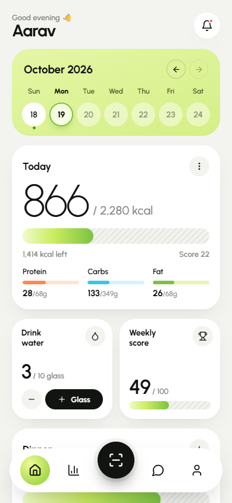<br/><sub><b>Mobile view</b></sub></td>
  </tr>
</table>

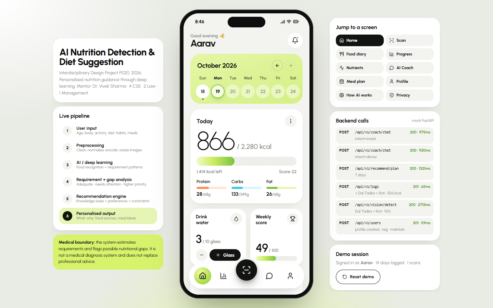<br/>
<sub><i>Desktop presentation mode — phone frame with live pipeline, demo navigator and API activity panels</i></sub>

</div>

---

## 

| Screen | What it does |
|---|---|
| 🧭 **Onboarding** | Six steps: about you, body (live BMI), activity, diet + allergies, goal, DPDP-style consent. Ends with your daily target. |
| 🏠 **Home** | Calorie ring + macros, 7-day nutrient check, AI meal idea, today’s meals, water tracker, weekly score |
| 📷 **Scan** | Food / Barcode / Label modes, live camera, photo upload, animated 5-stage vision pipeline, confidence + alternatives |
| 🍛 **Meal details** | Small/Medium/Large portions, 10 micronutrients, smart swaps, add to any meal slot |
| 📒 **Food diary** | Day-by-day log grouped by meal with source icons |
| 🔎 **Add food** | 100+ Indian foods, “fits my diet” filter, sort by nutrient density, AI picks |
| 📈 **Progress** | Day / Week / Month / Year calorie bars, score trend, weight log |
| 🧪 **Nutrient profile** | 11-nutrient gap analysis with an action plan and food sources |
| 💬 **AI Coach** | English + Hinglish chat, 25+ intents, voice input, tappable meal cards, medical guardrails |
| 🗓️ **Meal plan** | 7-day plan optimised for your gaps, swap meals, grocery list, export |
| 🔐 **Privacy** | Data stays on device, JSON export, erase-all |

---

## 

Everything is computed on the device from a curated knowledge base, so every answer is grounded in your own data:

- `src/data/foods.js` — 116 foods × 14 nutrients (IFCT 2017 / USDA)
- `src/data/meals.js` — 92 meal combos, 28 scan plates, 12 barcode products, 6 nutrition labels
- `src/engine/nutrition.js` — Mifflin-St Jeor energy, ICMR-NIN 2020 RDAs, gap thresholds, daily score
- `src/engine/recommend.js` — gap-closing meal ranking, 7-day planner, smart swaps, grocery list
- `src/engine/coach.js` — rule-based NLU (English + Hinglish), food lookups (“2 roti”), comparisons (“paneer vs chicken”)
- `src/engine/detector.js` — simulated vision pipeline (food recognition is simulated in this build)
- `ml/` — Python pipeline: data simulation, cleaning, gap model and recommender training (see [`ml/README.md`](ml/README.md))

`src/services/api.js` is a single mock backend whose functions mirror REST endpoints (`POST /api/v1/vision/detect`, `/coach/chat`, `/recommend/plan`…) — swap the bodies for `fetch()` calls to connect a real FastAPI + TensorFlow service.

> ⚕️ General guidance, not a medical diagnosis.

---

## 

```bash
git clone https://github.com/Chandankumar775/nutrisense-ai.git
cd nutrisense-ai
npm install
npm run dev        # http://localhost:5173
```

Tap **“Explore with a demo profile”** to load a vegetarian user with two weeks of meal history.

**Build the APK yourself:**

```bash
npm run build
npx cap sync android
cd android && ./gradlew assembleDebug
# → android/app/build/outputs/apk/debug/app-debug.apk
```

---

## 

Light grey ground, white 28px cards, lime calendar card, lime→leaf gradient bars over hatched tracks, huge hairline numerals (“256 KCAL”) and a black floating scan button. Type is **Urbanist** (self-hosted). Food photos are 116 free-licensed images from Wikimedia Commons, credited in-app.

---

## 

Interdisciplinary Design Project **P020** · Mentor **Dr. Vivek Sharma**

| CSE | Law | Management |
|---|---|---|
| Garveet Singh · Vishwas Ahuja · **Chandan Kumar** · Reedima | Prerna Singh · Mehak Kamboj | Kushagra Sharma |

<div align="center">


</div>
